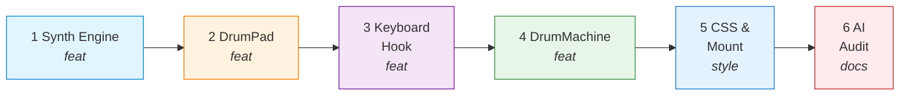

# WBS - Lab 3 Homework 1: Production Studio Drum Kit

**Objective:** Build a Drum Kit with 7 pads (W, A, S, D, J, K, L), supporting Web Audio API, Anti-repeat guard, Input focus isolation, and Visual hit log (A11y). Zero div-soup.

## Task Breakdown

| Task ID | Description | Commit Message | File(s) |
|---|---|---|---|
| HW1-00 | Init rules & WBS | `chore(hw1): init project rules and WBS` | `project-rules.md`, `TASK_DECOMPOSITION.md` |
| HW1-01 | Scaffold Vite React 19 | `chore(hw1): scaffold vite react 19 project` | `package.json`, `vite.config.js`, `src/main.jsx` |
| HW1-02 | Web Audio API Synth Engine | `feat(hw1): implement drum synth engine with web audio api` | `src/audio/DrumSynth.js` |
| HW1-03 | DrumPad Component (Memoized) | `feat(hw1): create memoized drum pad component with aria-pressed` | `src/components/DrumPad.jsx` |
| HW1-04 | Keyboard Hook (e.code, anti-repeat) | `feat(hw1): implement keyboard hook with e.code and anti-repeat guard` | `src/hooks/useDrumKeyboard.js` |
| HW1-05 | Main Drum Machine (Hit Log & Meter) | `feat(hw1): integrate drum machine with visual hit log` | `src/components/DrumMachine.jsx` |
| HW1-06 | CSS Modules & 375px Responsive | `style(hw1): add responsive studio layout and focus rings` | `src/components/DrumMachine.module.css` |
| HW1-07 | Mount in App | `feat(hw1): mount drum machine in app` | `src/App.jsx` |
| HW1-08 | AI Failure Audit | `docs(audit): add ai failure mode audit report` | `AI_FAILURE_AUDIT.md` |

## Flow

## Acceptance Criteria

- 7 pads correspond to 7 keys: W, A, S, D, J, K, L.
- Web Audio API generates standard sound (Kick, Snare, Hi-hat, Tom, Crash).
- Do not use keyCode (only e.code). Has `if (e.repeat) return;` to prevent OS spam.
- Typing keys when focused on `<input>` does not trigger pad.
- Pad button has `aria-pressed={isActive}`.
- Hit log history displayed in `<output aria-live="polite">`.
- Every AudioContext is `close()` on unmount (no audio leak).
- Zero `
` soup, Zero `var`.
- `AI_FAILURE_AUDIT.md` has >= 3 errors (Stale closure listener, AudioContext leak, keyCode).
